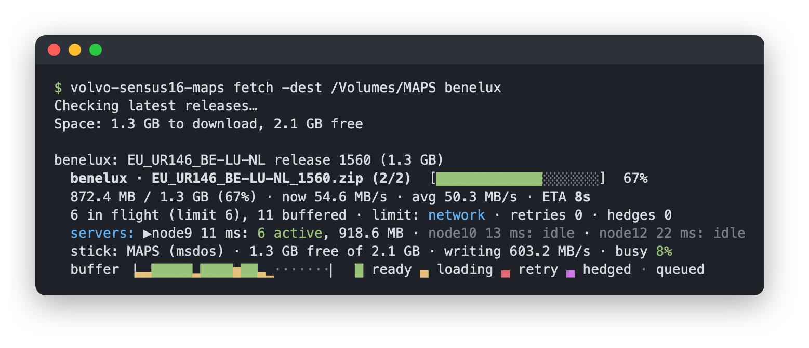

# volvo-sensus16-maps

> [!NOTE]
> :robot: To update the navigation on my Volvo, I have to click
> through the official 90s-vibe wizard application to download the maps
> onto an USB stick, which can then be read by the car. That wouldn't be too
> bad, except that it has to be done for every single region I care about.
> So I asked Claude to write me a quick tool to automate it. This is the result.
> Works well for me, but of course: no guarantees and provided as-is!

Download the latest Volvo Sensus Navigation map updates in one go,
straight onto a USB stick.

This is for cars with *Sensus Navigation 2016* (the SPA platform: XC90,
S90/V90, XC60 and friends, from model year 2016 until Google's system took
over). Volvo's own route is a separate "Sensus Update" downloader app per
region, each of which wants an empty stick. This tool fetches the regions
you choose (any that Volvo offers), checks every byte, and writes them to
the root of the stick, ready for the car; later it updates whatever is on
the stick.



This is an unofficial tool, not made or endorsed by Volvo Cars or Reloaded
Technologies. It downloads the same free map updates as Volvo's own
downloaders, from the same servers. Use it at your own risk.

## Build

Needs Go 1.27 or newer. Runs on macOS, Linux and Windows:

```
go install github.com/bwesterb/volvo-sensus16-maps@latest
```

or, from a clone, `go build -o volvo-sensus16-maps .`

macOS gets the most thorough treatment; on the others a few things are
best effort:

|                          | macOS          | Linux                     | Windows                          |
|--------------------------|----------------|---------------------------|----------------------------------|
| writes bypass the cache  | yes            | no                        | no                               |
| read-back from the stick | remount        | cache dropped per file    | may come from the cache          |
| `-eject`                 | `diskutil`     | `udisksctl`, if installed | no: use "Safely Remove Hardware" |
| default country          | region setting | `LANG`                    | `LANG`, if set                   |

Only macOS has been tested in practice; the Linux and Windows builds are
cross-compiled but untested.

## Use

```
./volvo-sensus16-maps fetch benelux france germany # put these regions on the stick
./volvo-sensus16-maps fetch                        # later: update the regions on the stick
./volvo-sensus16-maps fetch -eject                 # ... and eject the stick when done
./volvo-sensus16-maps fetch -verify                # also re-read and check everything on the stick
./volvo-sensus16-maps list                         # known regions, latest releases, what the stick has
./volvo-sensus16-maps list turkey                  # size and release of a region
./volvo-sensus16-maps fetch -dest STICK            # use this stick (or directory)
```

Without `-dest` it finds the stick itself: the removable FAT32, exFAT or
NTFS volume with Sensus maps on it, or else the only such volume, after
asking before it writes to one without maps. If that's ambiguous it lists
the candidates. `-dest` is the root of the USB stick, e.g. `/Volumes/STICK`
on macOS, `/media/you/STICK` on Linux or `E:\` on Windows (or any directory
to download into). The stick must be FAT32, exFAT or NTFS. Volvo recommends
64 GB, and 128 GB for the whole of Europe as one image; `fetch` checks that
what you ask for fits.

### Regions

A region is named like the last part of its download link on Volvo's "Sensus
Navigation 2016 map download" pages: `benelux` for
`https://sensusupdate.volvocars.com/osx/spa/benelux`, `na-texas-tx` for
Texas. All maps on those pages are built in; `list` shows them, grouped by
market: Europe, North America, South America, Africa & Middle East, India,
South-East Asia, Israel, Pacific, Taiwan, Turkey and Japan. Also built in is
`russia`, a European region Volvo no longer lists but still serves. A region
added later is looked up once, from Volvo's Windows downloader for it, and
remembered in a `regions.json` in the user configuration directory.

Most markets come both as regions that can be combined on one stick and as a
single map image of the whole market (`europe`, `north-america`, ...).
Israel, Pacific, Taiwan, Turkey and Japan come only as an image. An image
has fixed file names: one per stick, and not together with regions.

Korea and China aren't supported: their maps come from Volvo's own servers
in those countries, which don't serve elsewhere.

`fetch`:

1. Looks up the latest release of each region.
2. Checks that everything fits, then removes older releases of the regions
   it's about to download (the car already has those installed).
3. Downloads, resuming partial files from an earlier run.
4. Reads the new files back from the stick to check that it stored them
   correctly (on macOS after a remount, so nothing comes from memory).

Ctrl+C stops it straight away; rerun to continue. Afterwards, eject the
stick (`-eject`, or the usual way for your system) before pulling it out,
plug it into the car and the update installs while you drive.

While downloading, a status block shows progress, speed and time left; the
servers in use; what limits the speed, network or stick, highlighted in
colour so a switch stands out; the stick's write speed and how busy it is;
and the blocks in the buffer ahead of the writer, colour-coded as they
download (`█` ready, `▄` loading, red retry, magenta hedged, `·` queued).

Options: `-workers N` fixes the number of parallel downloads (default:
adaptive, 1–12), `-country XX` overrides the country used for the regions'
availability rules (default: from the system locale; if it can't be told,
the rules are applied as Volvo's app does when its location lookup fails),
`-no-verify` skips the read-back.

## How Volvo's downloader works

The per-region apps are built on Reloaded Technologies' "Super Node
Delivery". Each app knows just one package ID (in its bundle ID,
`com.reloadedtech.snd.spa64.<package>`) and looks up everything else:

| What     | Where |
|----------|-------|
| manifest | `https://cache.manifests.reloadedtech.com/manifests/<package>/current.json` (or `.xml`): latest release, files, sizes, MD5 and a CRC32 per 1 or 4 MiB chunk |
| servers  | `https://cache.manifests.reloadedtech.com/nodes/<partner>.json`: three download servers with weights |
| files    | `https://<server>/packages/<partner>/<package>/<version>/<file>`, fetched with Range requests |

So the downloaders never need updating for new map releases. There's no
catalogue of packages: the built-in regions' package IDs are listed in
`regions.go`, and others are read from the region's Windows downloader,
which carries its package ID as text.

## Design notes

Choices made here, mostly from measurements on a fast home connection and
an inexpensive 64 GB stick:

- **Polite to the servers.** HTTPS, connection reuse, at most 12 requests in
  flight (usually 2–5), exponential backoff with jitter on failures, halving
  the parallelism on a burst of errors, honouring the manifest's active flag
  and country rules. No telemetry.
- **One server at a time, the nearest.** One server can fill a fast
  connection with a few connections; using all of them at once was slower
  and much less steady, because connections to a more distant server lose
  out at the shared bottleneck and hold everything up. Servers are ranked by
  TCP connect time; one that fails three times in a row moves to the back.
- **Hedging.** Blocks are written in order, so one slow block holds up all
  the ones behind it. If the block needed next takes more than three times
  the usual request time (at least 2 s), it's also requested from the next
  server, and the first answer wins.
- **Adaptive parallelism.** Probe one more connection and keep it if
  throughput clearly improves; otherwise try one fewer. Back off when the
  stick, not the network, is the limit.
- **Sequential, uncached writes from a separate writer.** Sequential writes
  are faster on a stick, and on FAT32 writing past a gap zero-fills it.
  Through the buffer cache, macOS accepts writes far faster than a stick
  stores them, and closing a file (also on Ctrl+C) then waits for the
  backlog; uncached writes are as fast and leave none. (Linux doesn't make
  closing wait, and needs aligned buffers for uncached writes, so there they
  go through the cache.) Writing in its own goroutine lets downloading
  continue during the stick's slow phases; with a combined loop the two took
  turns, well below either's speed.
- **Checking.** Each chunk's CRC32 on arrival, each file's MD5 before it
  gets its final name, and a read-back from the stick at the end, bypassing
  the system's cache where possible. A file that fails the read-back becomes
  a `.part` again and the next run repairs just the bad chunks.

On a fast connection the stick is likely the bottleneck: inexpensive
sticks alternate between fast and much slower phases during a long write,
and their average can be well below what the connection delivers. The
status block shows which one limits; a faster stick is the way to faster
updates.

## License

MIT; see [LICENSE](LICENSE).
